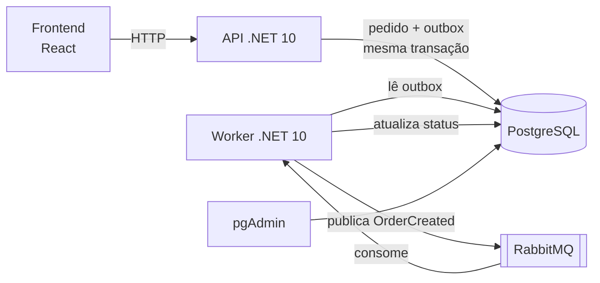

# TMB Orders — Sistema de Gestão de Pedidos

Sistema de gestão de pedidos com **processamento assíncrono via mensageria**.
Ao criar um pedido, a API grava no PostgreSQL e publica o evento `OrderCreated`.
Um worker consome o evento e avança o status do pedido: **Pendente → Processando → Finalizado**.

> 🚧 Projeto em construção — Fase 1 (infraestrutura e base da solução) concluída.

## Arquitetura



## Stack

| Camada | Tecnologia |
|---|---|
| Backend | .NET 10 (LTS) — ASP.NET Core Minimal APIs |
| Acesso a dados | Entity Framework Core 10 + Npgsql |
| Banco de dados | PostgreSQL 17 |
| Mensageria | RabbitMQ 4 (com painel de administração) |
| Administração do banco | pgAdmin 4 |
| Infraestrutura | Docker Compose |

## Estrutura da solução

```
src/
├── TmbOrders.Domain           # Regras de negócio puras (Pedido, status, histórico)
├── TmbOrders.Infrastructure   # EF Core, migrations, RabbitMQ, outbox, health checks
├── TmbOrders.ServiceDefaults  # Configurações comuns (endpoints de health, telemetria)
├── TmbOrders.Api              # API REST
└── TmbOrders.Worker           # Publicador do outbox + consumidor de eventos
infra/
└── pgadmin/servers.json       # Servidor do Postgres já cadastrado no pgAdmin
```

## Como rodar

**Pré-requisito:** Docker Desktop em execução.

```bash
# 1. Crie o arquivo de variáveis de ambiente
cp .env.example .env          # Windows PowerShell: copy .env.example .env

# 2. Suba todo o ambiente
docker compose up -d --build
```

| Serviço | URL |
|---|---|
| API | http://localhost:5080 |
| Health da API | http://localhost:5080/health |
| Worker (health) | http://localhost:5081/health |
| RabbitMQ (painel) | http://localhost:15672 |
| pgAdmin | http://localhost:5050 |

Logins usam os valores definidos no `.env`.

## Health checks

| Endpoint | O que verifica |
|---|---|
| `/health/live` | O processo está no ar |
| `/health/ready` | Dependências: PostgreSQL e RabbitMQ |
| `/health` | Relatório completo em JSON |

O `docker-compose.yml` usa esses endpoints nos `healthcheck` de cada serviço, e a ordem de subida
respeita `depends_on: condition: service_healthy`.

## Decisões técnicas

- **.NET 10 em vez de .NET 8:** o .NET 10 é a versão LTS atual; o suporte do .NET 8 terminou em novembro/2026.
- **EF Core + migrations automáticas:** a API aplica as migrations pendentes ao iniciar. Somente a API
  migra, e o worker só sobe depois que a API está saudável, evitando corrida entre processos.
- **Colunas com os nomes do enunciado:** a tabela `pedidos` usa `id`, `cliente`, `produto`, `valor`,
  `status` e `data_criacao`. O status é gravado como texto, o que facilita a leitura no banco.
- **Duas barreiras de idempotência:** a tabela `mensagens_processadas` (chave `message_id + consumidor`) e
  um índice único `(pedido_id, status)` no histórico, que impede a mesma transição de ser gravada duas vezes.
- **Central Package Management:** versões de todos os pacotes NuGet ficam em `Directory.Packages.props`.
- **Segredos fora do código:** tudo vem de variáveis de ambiente; o `docker compose` falha com uma mensagem
  clara se uma senha obrigatória não estiver definida no `.env`.

## Desenvolvimento

Gerar uma nova migration (requer o SDK do .NET 10):

```bash
dotnet tool restore
dotnet ef migrations add NomeDaMigration --project src/TmbOrders.Infrastructure --startup-project src/TmbOrders.Api --output-dir Persistence/Migrations
```
