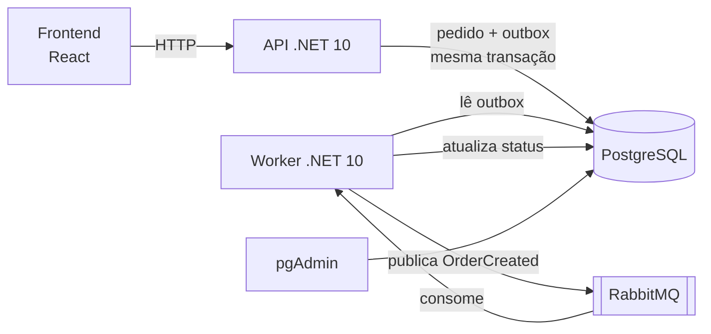
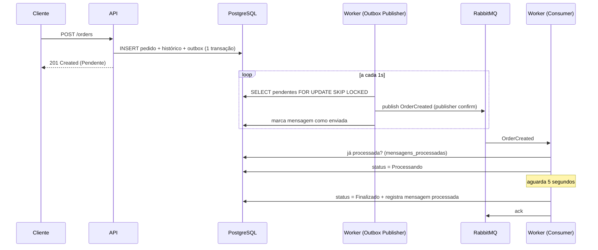

# TMB Orders — Sistema de Gestão de Pedidos

Sistema de gestão de pedidos com **processamento assíncrono via mensageria**.
Ao criar um pedido, a API grava no PostgreSQL e publica o evento `OrderCreated`.
Um worker consome o evento e avança o status do pedido: **Pendente → Processando → Finalizado**.

> 🚧 Projeto em construção — Fase 3 (frontend) concluída.

## Arquitetura



## Stack

| Camada | Tecnologia |
|---|---|
| Backend | .NET 10 (LTS) — ASP.NET Core Minimal APIs |
| Acesso a dados | Entity Framework Core 10 + Npgsql |
| Banco de dados | PostgreSQL 17 |
| Mensageria | RabbitMQ 4 (com painel de administração) |
| Administração do banco | pgAdmin 4 |
| Frontend | React 19 + Vite + TypeScript, Tailwind CSS 4, TanStack Query, Radix UI |
| Infraestrutura | Docker Compose + Nginx (serve o frontend e faz proxy para a API) |

## Estrutura da solução

```
src/
├── TmbOrders.Domain           # Regras de negócio puras (Pedido, status, histórico)
├── TmbOrders.Infrastructure   # EF Core, migrations, RabbitMQ, outbox, health checks
├── TmbOrders.ServiceDefaults  # Configurações comuns (endpoints de health, telemetria)
├── TmbOrders.Api              # API REST
└── TmbOrders.Worker           # Publicador do outbox + consumidor de eventos
frontend/                      # React + Vite (servido por Nginx no Docker)
infra/
└── pgadmin/servers.json       # Servidor do Postgres já cadastrado no pgAdmin
```

## Como rodar

**Pré-requisito:** Docker Desktop em execução.

```bash
# 1. Crie o arquivo de variáveis de ambiente
cp .env.example .env          # Windows PowerShell: copy .env.example .env

# 2. Suba todo o ambiente
docker compose up -d --build
```

| Serviço | URL |
|---|---|
| **Frontend** | **http://localhost:3000** |
| API | http://localhost:5080 |
| Health da API | http://localhost:5080/health |
| Worker (health) | http://localhost:5081/health |
| RabbitMQ (painel) | http://localhost:15672 |
| pgAdmin | http://localhost:5050 |

Logins usam os valores definidos no `.env`.

## Endpoints

| Método | Rota | Descrição |
|---|---|---|
| POST | `/orders` | Cria um pedido (status inicial **Pendente**) |
| GET | `/orders` | Lista os pedidos (filtro opcional `?status=Finalizado`) |
| GET | `/orders/{id}` | Detalhes do pedido com o **histórico de status** |

Exemplo de criação:

```bash
curl -X POST http://localhost:5080/orders \
  -H "Content-Type: application/json" \
  -d '{"cliente":"Maria Silva","produto":"Notebook","valor":4599.90}'
```

O arquivo `src/TmbOrders.Api/TmbOrders.Api.http` tem todas as requisições prontas para rodar no
Visual Studio, Rider ou VS Code (extensão REST Client). Erros seguem o padrão **ProblemDetails (RFC 9457)**.

## Fluxo de mensageria



**Mensagem publicada** (exchange `orders.events`, routing key `order.created`):

- Propriedades AMQP: `message_id`, `correlation_id` (= OrderId), `type` (= OrderCreated), entrega persistente.
- Headers: `EventType: OrderCreated`, `CorrelationId: <OrderId>`, `traceparent`.
- Corpo: envelope JSON com `messageId`, `eventType`, `correlationId`, `occurredAt` e `data`.

### Confiabilidade

| Problema | Como é tratado |
|---|---|
| RabbitMQ fora do ar ao criar pedido | **Outbox Pattern**: o evento fica no banco e é publicado quando o broker voltar |
| Broker não recebeu a mensagem | **Publisher confirms**: só marca como enviada após confirmação do RabbitMQ |
| Mensagem entregue duas vezes | **Consumidor idempotente** (3 camadas: tabela de mensagens processadas, regra de domínio e índice único no histórico) |
| Erro temporário no processamento | `nack` com requeue: nova tentativa |
| Mensagem que sempre falha | Fila **quorum** com `x-delivery-limit`: após 5 entregas vai para a **DLQ** `orders.order-created.dlq` |
| JSON inválido / pedido inexistente | Vai direto para a DLQ (tentar de novo não resolveria) |
| Vários workers em paralelo | `FOR UPDATE SKIP LOCKED` no outbox; índice único impede transição duplicada |

## Health checks

| Endpoint | O que verifica |
|---|---|
| `/health/live` | O processo está no ar |
| `/health/ready` | Dependências: PostgreSQL e RabbitMQ |
| `/health` | Relatório completo em JSON |

O `docker-compose.yml` usa esses endpoints nos `healthcheck` de cada serviço, e a ordem de subida
respeita `depends_on: condition: service_healthy`.

## Decisões técnicas

- **.NET 10 em vez de .NET 8:** o .NET 10 é a versão LTS atual; o suporte do .NET 8 terminou em novembro/2026.
- **EF Core + migrations automáticas:** a API aplica as migrations pendentes ao iniciar. Somente a API
  migra, e o worker só sobe depois que a API está saudável, evitando corrida entre processos.
- **Colunas com os nomes do enunciado:** a tabela `pedidos` usa `id`, `cliente`, `produto`, `valor`,
  `status` e `data_criacao`. O status é gravado como texto, o que facilita a leitura no banco.
- **Duas barreiras de idempotência:** a tabela `mensagens_processadas` (chave `message_id + consumidor`) e
  um índice único `(pedido_id, status)` no histórico, que impede a mesma transição de ser gravada duas vezes.
- **Central Package Management:** versões de todos os pacotes NuGet ficam em `Directory.Packages.props`.
- **Segredos fora do código:** tudo vem de variáveis de ambiente; o `docker compose` falha com uma mensagem
  clara se uma senha obrigatória não estiver definida no `.env`.

## Frontend

- **Dashboard** com total de pedidos, pendentes, em processamento, finalizados e valor finalizado.
- **Tabela responsiva** (vira lista de cartões no celular), com filtro por status e busca.
- **Criação de pedido** em modal, com máscara de valor em R$ e erros da API exibidos por campo.
- **Detalhes do pedido** com linha do tempo do histórico de status e tempo entre etapas.
- **Feedback visual de status:** badge animado em "Processando", linha destacada quando o status muda
  e notificação (toast) ao entrar em processamento e ao finalizar.
- **Atualização automática:** polling a cada 1,5 s enquanto houver pedido em andamento, e a cada 10 s quando
  tudo estiver finalizado.
- Tema claro/escuro, estados de carregamento (skeleton), vazio e erro, e acessibilidade (teclado, aria).

No Docker, o Nginx serve o build e redireciona `/api/*` para a API, então o navegador fala com uma única
origem (sem CORS). Em desenvolvimento, o Vite faz o mesmo papel:

```bash
cd frontend
npm install
npm run dev        # http://localhost:5173 (a API precisa estar em http://localhost:5080)
```

## Desenvolvimento

Gerar uma nova migration (requer o SDK do .NET 10):

```bash
dotnet tool restore
dotnet ef migrations add NomeDaMigration --project src/TmbOrders.Infrastructure --startup-project src/TmbOrders.Api --output-dir Persistence/Migrations
```
