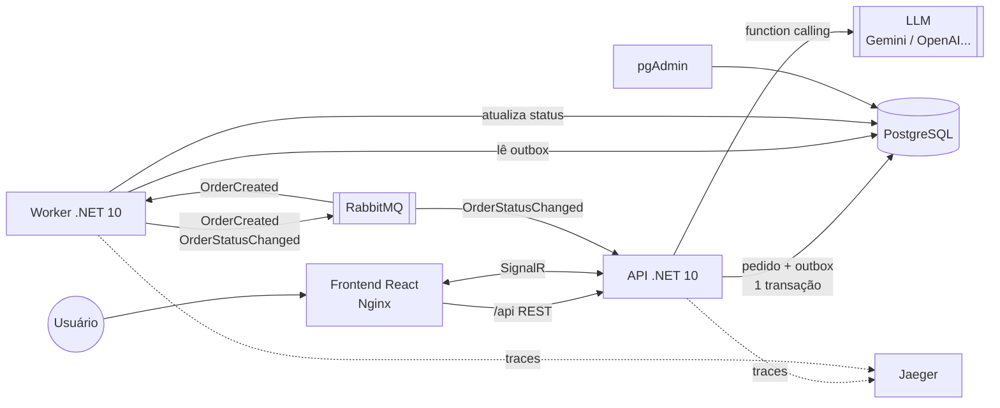
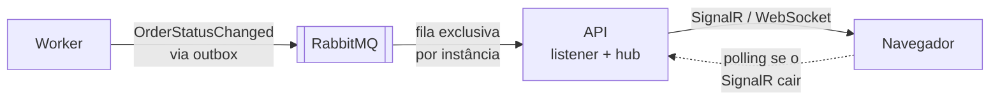
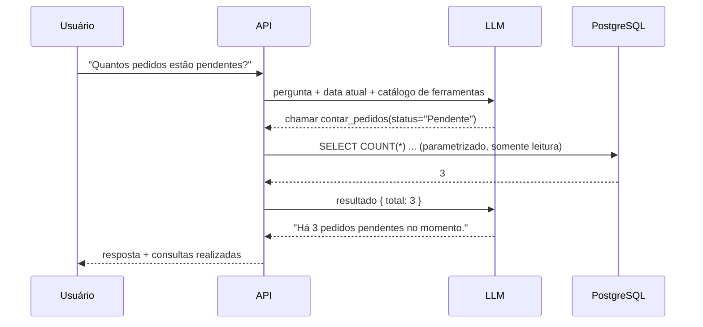

# TMB Orders — Sistema de Gestão de Pedidos

[](https://github.com/marcusguarani/tmb-orders/actions/workflows/ci.yml)

Sistema de gestão de pedidos com **processamento assíncrono via mensageria**. Ao criar um pedido, a API
grava no PostgreSQL e publica o evento `OrderCreated` no RabbitMQ. Um worker consome o evento e avança o
status do pedido: **Pendente → Processando → (5 s) → Finalizado**. A interface acompanha tudo em tempo real.

    

## Sumário

- [Como rodar](#como-rodar)
- [Requisitos do desafio](#requisitos-do-desafio)
- [Arquitetura](#arquitetura)
- [Justificativa das tecnologias](#justificativa-das-tecnologias)
- [API](#api)
- [Mensageria e confiabilidade](#mensageria-e-confiabilidade)
- [Tempo real com fallback](#tempo-real-signalr-com-fallback)
- [Módulo de IA](#módulo-de-ia--pergunte-sobre-os-pedidos)
- [Tracing ponta a ponta](#tracing-ponta-a-ponta-opentelemetry--jaeger)
- [Frontend](#frontend)
- [Testes automatizados](#testes-automatizados)
- [Decisões técnicas](#decisões-técnicas)
- [Solução de problemas](#solução-de-problemas)

## Como rodar

**Pré-requisito:** Docker Desktop em execução. Nada mais precisa estar instalado.

```bash
# 1. Crie o arquivo de variáveis de ambiente (e, se quiser, troque as senhas)
cp .env.example .env          # Windows: copy .env.example .env

# 2. Suba todo o ambiente com um único comando
docker compose up -d --build
```

Em cerca de 1 minuto tudo estará no ar. As **migrations são aplicadas automaticamente** e a ordem de subida
respeita os health checks de cada serviço.

| Serviço | URL | Acesso |
|---|---|---|
| **Frontend** | **http://localhost:3000** | — |
| API | http://localhost:5080 | — |
| Health da API | http://localhost:5080/health | — |
| Worker (health) | http://localhost:5081/health | — |
| RabbitMQ (painel) | http://localhost:15672 | usuário `tmb` / senha `RABBITMQ_PASSWORD` do `.env` |
| pgAdmin (banco) | http://localhost:5050 | `admin@tmborders.com` / `PGADMIN_PASSWORD` do `.env` (servidor já cadastrado) |
| Jaeger (traces) | http://localhost:16686 | — |

> O **módulo de IA é opcional** e precisa de uma chave de API. Veja [Configuração da IA](#configuração).
> Sem ela, todo o resto funciona normalmente e a tela do assistente explica como ativar.

## Requisitos do desafio

### Obrigatórios

| Requisito | Onde / como |
|---|---|
| Backend .NET, frontend React, PostgreSQL | .NET 10, React 19 + Vite, PostgreSQL 17 |
| `POST /orders`, `GET /orders`, `GET /orders/{id}` | [`OrderEndpoints.cs`](src/TmbOrders.Api/Orders/OrderEndpoints.cs) |
| Atributos id, cliente, produto, valor, status, data_criacao | Tabela `pedidos` e JSON da API com exatamente esses nomes |
| Persistir e publicar mensagem ao criar | Pedido + mensagem no outbox **na mesma transação** (Outbox Pattern) |
| Worker: Processando → 5 s → Finalizado | [`OrderProcessor.cs`](src/TmbOrders.Worker/Processing/OrderProcessor.cs) |
| Sequência obrigatória de status | Regra no domínio: [`Order.TryAdvanceTo`](src/TmbOrders.Domain/Orders/Order.cs) (pular etapa gera erro) |
| Consumidor idempotente | 3 camadas: mensagens processadas, regra de domínio e índice único no histórico |
| `CorrelationId = OrderId` e `EventType = OrderCreated` | Nas propriedades AMQP, nos headers e no corpo da mensagem |
| Health checks de API, banco e mensageria | `/health/live`, `/health/ready`, `/health` |
| Listar (tabela responsiva), criar, ver detalhes, feedback de status | Tela de pedidos, modal de criação, tela de detalhes, badges, toasts e animações |
| Subir tudo com um comando, incluindo admin do banco | `docker compose up -d --build` (API, worker, frontend, PostgreSQL, **pgAdmin**, RabbitMQ, Jaeger) |
| Segredos fora do código | Variáveis de ambiente (`.env`); o compose falha com mensagem clara se faltar senha |
| Migrations automáticas | Aplicadas pela API ao iniciar |
| Healthchecks na orquestração | `healthcheck` + `depends_on: condition: service_healthy` |
| README, `.env.example`, justificativa das tecnologias | Este arquivo e [`.env.example`](.env.example) |

### Diferenciais (bônus)

| Diferencial | Pontos | Implementação |
|---|---|---|
| Outbox Pattern | +3 | Tabela `outbox_mensagens`, publicador com `FOR UPDATE SKIP LOCKED` e *publisher confirms* |
| Histórico de status | +3 | Tabela `pedidos_historico_status` + linha do tempo na tela de detalhes |
| Tempo real com fallback | +3 | SignalR (WebSocket → SSE → long polling) + polling automático quando a conexão cai |
| Testes de integração com dependências reais, isolados e descartáveis | +1 | Testcontainers (PostgreSQL + RabbitMQ) com API e Worker reais |
| Tracing ponta a ponta | +2 | OpenTelemetry + Jaeger: **um único trace** da requisição HTTP até o SignalR, atravessando a fila |
| Golden tests | +2 | Snapshots versionados dos contratos JSON (API, mensagens e SignalR) |
| Módulo IA/Analytics com LLM | +5 | Function calling com 7 consultas seguras + tela de chat |
| Diagramas de arquitetura | — | Diagramas Mermaid neste README |

## Arquitetura



### Estrutura da solução

```
src/
├── TmbOrders.Domain           # Regras de negócio puras (Pedido, status, histórico) — sem dependências
├── TmbOrders.Infrastructure   # EF Core, migrations, RabbitMQ, outbox, health checks, telemetria de mensageria
├── TmbOrders.ServiceDefaults  # Configurações comuns: health checks e OpenTelemetry
├── TmbOrders.Api              # API REST, hub SignalR, módulo de IA
└── TmbOrders.Worker           # Publicador do outbox + consumidor de OrderCreated
frontend/                      # React + Vite + TypeScript (servido por Nginx no Docker)
tests/
├── TmbOrders.UnitTests        # Domínio, validação e golden tests dos contratos
└── TmbOrders.IntegrationTests # API + Worker reais com PostgreSQL e RabbitMQ em Testcontainers
infra/pgadmin/servers.json     # Servidor do Postgres já cadastrado no pgAdmin
.github/workflows/ci.yml       # Pipeline de CI
```

## Justificativa das tecnologias

| Escolha | Por quê |
|---|---|
| **.NET 10** | Versão LTS atual. O suporte do .NET 8 terminou em novembro de 2026 |
| **Minimal APIs** | Pouca cerimônia para 3 endpoints, com resultados tipados (`TypedResults`) e OpenAPI automático |
| **EF Core + Npgsql** (acesso a dados) | Migrations versionadas, consultas tipadas e parametrizadas (sem risco de SQL injection) e mapeamento rico (backing fields, shadow properties). Para a única consulta com `FOR UPDATE SKIP LOCKED`, usei SQL interpolado e parametrizado |
| **RabbitMQ** (mensageria) | Leve, roda em um container, tem painel visual e oferece o necessário para confiabilidade: *publisher confirms*, ack manual, filas **quorum** com limite de entregas e **dead-letter queue**. Kafka seria exagero para um fluxo de comandos simples |
| **RabbitMQ.Client** direto (sem MassTransit) | Deixa explícito o que acontece por baixo (ack, nack, DLQ, confirms), que é justamente o que o desafio avalia. O MassTransit também passou a ter licença comercial nas versões novas |
| **Outbox Pattern próprio** | Garante que pedido e evento são gravados juntos. Implementação pequena e transparente, fácil de explicar e testar |
| **SignalR** (tempo real) | Nativo do ASP.NET Core, com reconexão automática e queda para SSE ou long polling quando o WebSocket é bloqueado |
| **React + Vite + TypeScript** | Build rápido e tipagem ponta a ponta com o contrato da API |
| **Tailwind CSS 4 + Radix UI** (estilização) | Design consistente sem CSS solto. O Radix fornece componentes acessíveis (modal com foco preso, teclado, aria) |
| **TanStack Query** | Cache, polling inteligente e atualização otimista. O SignalR atualiza o mesmo cache |
| **Docker Compose + Nginx** (infraestrutura) | Um comando sobe tudo. O Nginx serve o frontend e faz proxy de `/api`, então o navegador fala com uma única origem (sem CORS) |
| **OpenTelemetry + Jaeger** | Padrão aberto de observabilidade. O Jaeger v2 recebe OTLP nativamente |
| **xUnit + Testcontainers** | Testes com PostgreSQL e RabbitMQ reais, criados e destruídos a cada execução |
| **LLM via API compatível com OpenAI** (provedor de IA) | Um único cliente funciona com OpenAI, Google Gemini, Groq ou Ollama local, trocando só o `.env`. Na demo usei o **Google Gemini**, pela cota gratuita |

## API

| Método | Rota | Descrição |
|---|---|---|
| POST | `/orders` | Cria um pedido (status inicial **Pendente**) |
| GET | `/orders` | Lista os pedidos, do mais recente ao mais antigo (filtro opcional `?status=Finalizado`) |
| GET | `/orders/{id}` | Detalhes do pedido com o **histórico de status** e o `trace_id` |
| POST | `/analytics/ask` | Pergunta em linguagem natural sobre os pedidos (módulo de IA) |
| GET | `/analytics/status` | Indica se o módulo de IA está configurado |
| WS | `/hubs/orders` | Hub SignalR com os eventos `OrderCreated` e `OrderStatusChanged` |
| GET | `/health`, `/health/live`, `/health/ready` | Health checks |
| GET | `/openapi/v1.json` | Documento OpenAPI |

```bash
curl -X POST http://localhost:5080/orders \
  -H "Content-Type: application/json" \
  -d '{"cliente":"Maria Silva","produto":"Notebook","valor":4599.90}'
```

**Validações** (iguais no frontend e na API):

| Campo | Regra |
|---|---|
| `cliente` | Obrigatório, até 150 caracteres, **apenas letras** (com acentos), espaço, apóstrofo e hífen. Ex.: "João", "Ana-Maria", "D'Ávila" |
| `produto` | Obrigatório, até 150 caracteres |
| `valor` | Obrigatório, maior que zero, até R$ 1 bilhão, no máximo 2 casas decimais |

Erros seguem o padrão **ProblemDetails (RFC 9457)**, com os erros por campo. O arquivo
[`TmbOrders.Api.http`](src/TmbOrders.Api/TmbOrders.Api.http) tem todas as requisições prontas para rodar no
Visual Studio, Rider ou VS Code (extensão REST Client).

## Mensageria e confiabilidade


**Mensagem publicada** (exchange `orders.events`, routing key `order.created`):

- Propriedades AMQP: `message_id`, `correlation_id` (= OrderId), `type` (= OrderCreated), entrega persistente.
- Headers: `EventType: OrderCreated`, `CorrelationId: <OrderId>`, `traceparent`.
- Corpo: envelope JSON com `messageId`, `eventType`, `correlationId`, `occurredAt` e `data`.

| Problema | Como é tratado |
|---|---|
| RabbitMQ fora do ar ao criar pedido | **Outbox Pattern**: o evento fica no banco e é publicado quando o broker voltar |
| Broker não recebeu a mensagem | **Publisher confirms**: só marca como enviada após a confirmação do RabbitMQ |
| Mensagem entregue duas vezes | **Consumidor idempotente** em 3 camadas: tabela de mensagens processadas, regra de domínio e índice único `(pedido_id, status)` no histórico |
| Erro temporário no processamento | `nack` com requeue: nova tentativa |
| Mensagem que sempre falha | Fila **quorum** com `x-delivery-limit`: após 5 entregas vai para a **DLQ** `orders.order-created.dlq` |
| JSON inválido / pedido inexistente | Vai direto para a DLQ (tentar de novo não resolveria) |
| Vários workers em paralelo | `FOR UPDATE SKIP LOCKED` no outbox; o índice único impede transição duplicada |
| Worker parado | Os pedidos ficam Pendentes na fila e são processados quando o worker volta |

## Tempo real (SignalR) com fallback



1. A cada mudança de status, o worker grava um evento `OrderStatusChanged` no **outbox, na mesma transação**
   do status, e "acorda" o publicador na hora (sem esperar o ciclo de 1 s).
2. A API escuta esses eventos com uma **fila temporária exclusiva por instância**: se houver várias APIs
   rodando, todas recebem todos os eventos e cada uma avisa os seus clientes conectados.
3. O hub SignalR envia os eventos ao navegador, que atualiza o cache do TanStack Query na hora: tabela,
   cartões, linha do tempo e notificações reagem sem nova requisição.

| Situação | Comportamento |
|---|---|
| SignalR conectado | Eventos por push; polling apenas de segurança a cada 30 s |
| Conexão caiu | Indicador "Reconectando..."; reconexão automática e **polling a cada 1,5 s** enquanto isso |
| SignalR indisponível | Indicador "Modo polling"; tudo continua funcionando e a conexão é tentada a cada 10 s |
| Reconectou | Recarrega os dados para recuperar eventos perdidos durante a desconexão |
| WebSocket bloqueado pela rede | O cliente SignalR cai para Server-Sent Events ou long polling |

Para ver o fallback: com a tela aberta, rode `docker compose restart api` e observe o indicador no topo.

## Módulo de IA — Pergunte sobre os pedidos

Tela **Assistente IA** (http://localhost:3000/assistente) e endpoint `POST /analytics/ask`:

```bash
curl -X POST http://localhost:5080/analytics/ask \
  -H "Content-Type: application/json" \
  -d '{"pergunta":"Qual o valor total de pedidos finalizados este mês?"}'
```

### Como funciona (function calling)



**Por que function calling em vez de deixar a LLM gerar SQL (text-to-SQL)?**

| | Text-to-SQL | Function calling (escolhido) |
|---|---|---|
| Segurança | A LLM escreve SQL arbitrário (risco de injeção, DELETE, vazamento) | A LLM só escolhe entre 7 funções somente leitura e parametrizadas |
| Corretude | Pode errar joins, fuso horário e regras de negócio | Regras (fuso, "aprovado" = Finalizado, tempo pelo histórico) ficam no código, testadas |
| Testabilidade | Difícil | Cada ferramenta tem teste de integração com banco real |
| Transparência | SQL difícil de auditar | A tela mostra quais consultas foram feitas e os resultados |

**Ferramentas:** `contar_pedidos`, `resumo_por_status`, `valor_dos_pedidos`, `tempo_medio_processamento`
(pelo histórico: espera na fila, execução e total), `listar_pedidos`, `ranking_clientes` e `pedidos_por_dia`.

**Cuidados:**

- **Datas no fuso de Brasília:** "hoje" e "este mês" são interpretados em `America/Sao_Paulo`, não em UTC.
- **Anti-alucinação:** o prompt exige usar as ferramentas e proíbe inventar números. A tela exibe as consultas feitas.
- **Erros recuperáveis:** parâmetros inválidos voltam como `{ "erro": ... }` para o modelo corrigir sozinho.
- **Resiliência:** falhas temporárias do provedor (429 e 5xx) têm **retry automático com backoff exponencial**,
  respeitando o `Retry-After`.
- **Limites:** até 5 rodadas de ferramentas por pergunta, perguntas de até 500 caracteres e **rate limit** de
  10 perguntas por minuto por IP (protege o custo).
- **Compatibilidade com o Gemini 3:** preserva a `thought_signature` que o Gemini exige de volta no function calling.
- A chamada à LLM aparece no **trace do Jaeger** (`ai.ask` → `ai.tool ...` → SQL e HTTP).

### Configuração

No `.env` (exemplo com Google Gemini, que tem cota gratuita: crie a chave em https://aistudio.google.com/apikey,
em um projeto **sem faturamento** para garantir custo zero):

```bash
AI_BASE_URL=https://generativelanguage.googleapis.com/v1beta/openai
AI_API_KEY=sua-chave
AI_MODEL=gemini-3.5-flash-lite
AI_REASONING_EFFORT=low
```

Depois rode `docker compose up -d --force-recreate api`. Outras opções (OpenAI, Groq, Ollama local) estão no
`.env.example`.

## Tracing ponta a ponta (OpenTelemetry + Jaeger)

Cada pedido gera **um único trace** que atravessa todos os serviços e a fila:

```
tmb-api     POST /orders
tmb-api       └ INSERT pedidos + histórico + outbox          (Npgsql)
tmb-worker      └ order.created publish                      (Producer)
tmb-worker        └ orders.order-created process             (Consumer)
tmb-worker          ├ UPDATE status = Processando             (Npgsql)
tmb-worker          ├ order.status-changed publish            (Producer)
tmb-api             │  └ amq.gen-… process → SignalR          (Consumer)
tmb-worker          ├ UPDATE status = Finalizado              (Npgsql)
tmb-worker          └ order.status-changed publish            (Producer)
tmb-api                └ amq.gen-… process → SignalR          (Consumer)
```

Como o contexto do trace sobrevive à passagem pela fila:

1. A API grava o `traceparent` da requisição **junto com a mensagem no outbox**.
2. O publicador abre um span `publish` (Producer) como filho desse contexto e envia o header W3C
   `traceparent` na mensagem AMQP.
3. O consumidor lê o header e abre o span `process` (Consumer) como filho. Tudo o que ele faz
   (consultas, novos eventos no outbox) herda o mesmo trace.

Detalhes:

- Instrumentação de ASP.NET Core, Npgsql, HttpClient e spans próprios de mensageria, seguindo as convenções
  semânticas do OpenTelemetry (`messaging.system`, `messaging.message.id`, `messaging.message.conversation_id`).
- Um *sampler* customizado descarta consultas que não pertencem a nenhum trace (polling do outbox e health
  checks), evitando milhares de traces irrelevantes.
- O `trace_id` da criação fica gravado no pedido, e a tela de detalhes tem um **link direto para o trace no Jaeger**.
- Os logs incluem `TraceId`/`SpanId`, então dá para ir de uma linha de log ao trace correspondente.

## Frontend

- **Dashboard** com total de pedidos, pendentes, em processamento, finalizados e valor finalizado.
- **Tabela responsiva** (vira lista de cartões no celular), com filtro por status, busca e **paginação de 10 em 10**.
- **Criação de pedido em modal:** campos obrigatórios sinalizados com `*`, nome do cliente aceitando apenas
  letras (números e símbolos são bloqueados já na digitação), máscara de valor em R$ e erros da API exibidos
  por campo. O modal só fecha pelo **X** ou por **Cancelar**, sem perder o que foi digitado por um clique fora.
- **Detalhes do pedido** com linha do tempo do histórico, tempo entre etapas e link para o trace no Jaeger.
- **Feedback visual de status:** badge animado em "Processando", linha destacada quando o status muda e
  notificações ao entrar em processamento e ao finalizar.
- **Tempo real** com indicador de conexão (Tempo real / Reconectando / Modo polling).
- **Assistente IA** em formato de chat, com perguntas sugeridas e a lista de consultas feitas ao banco.
- Tema claro e escuro, *skeletons* de carregamento, estados de vazio e erro, acessibilidade (teclado, aria)
  e *code splitting* das páginas secundárias.

> A paginação é feita no cliente, pois o enunciado pede que `GET /orders` liste todos os pedidos.
> Para volumes grandes, a evolução natural é paginação no servidor (`?page=&pageSize=`).

Para desenvolver o frontend fora do Docker (o Vite faz o proxy de `/api` como o Nginx):

```bash
cd frontend
npm install
npm run dev        # http://localhost:5173 (a API precisa estar em http://localhost:5080)
```

## Testes automatizados

```bash
dotnet test TmbOrders.slnx
```

Requer apenas o **Docker em execução**: os testes de integração criam os próprios containers.

| Projeto | O que cobre |
|---|---|
| **UnitTests / Domain** | Regras do pedido: criação, sequência obrigatória de status, transição repetida ignorada (idempotência), pular etapa gera erro |
| **UnitTests / Api** | Validações do POST /orders (incluindo nome só com letras) e contratos de mensageria |
| **UnitTests / Golden** | **Golden tests** dos contratos JSON: respostas da API, mensagens do RabbitMQ e eventos do SignalR |
| **IntegrationTests** | **Dependências reais em ambiente isolado e descartável** (Testcontainers): PostgreSQL e RabbitMQ em containers, com a API e o Worker reais rodando em memória (`WebApplicationFactory`) |

Cenários de integração:

- POST grava pedido, histórico e mensagem de outbox **na mesma transação**, com `CorrelationId = OrderId` e `EventType = OrderCreated`.
- Validação retorna 400 com erros por campo; pedido inexistente retorna 404; health check reporta banco e mensageria.
- **Fluxo completo:** API → outbox → RabbitMQ → Worker → Finalizado, com histórico na ordem correta.
- **Idempotência:** a mesma mensagem entregue duas vezes é processada uma única vez.
- **Concorrência:** duas instâncias processando a mesma mensagem ao mesmo tempo, e só uma efetiva a mudança.
- **Módulo de IA:** cada ferramenta contra o banco real e o *agent loop* com um modelo falso (determinístico,
  sem chamar provedor externo).

### Golden tests

Os arquivos `tests/TmbOrders.UnitTests/Golden/*.golden.json` são a "fotografia" oficial dos contratos JSON.
Se alguém alterar um contrato sem querer (renomear um campo, mudar o formato de uma data), o teste falha e
mostra a diferença. Quando a mudança for intencional:

```bash
UPDATE_GOLDEN=1 dotnet test tests/TmbOrders.UnitTests     # PowerShell: $env:UPDATE_GOLDEN=1; dotnet test ...
```

O diff dos arquivos golden aparece no Git, e toda mudança de contrato fica explícita no code review.
Esses testes já pegaram um problema real: as mensagens do RabbitMQ gravavam "João" como `João`,
diferente do padrão da API.

### Integração contínua

O workflow [`ci.yml`](.github/workflows/ci.yml) roda a cada push: build e testes do backend (incluindo os
Testcontainers, já que o Docker está disponível no runner do GitHub) e typecheck e build do frontend.

## Decisões técnicas

- **Regras no domínio:** a sequência de status e a idempotência das transições ficam na entidade `Order`,
  testadas sem banco. API e Worker só orquestram.
- **Migrations automáticas, executadas só pela API:** o worker só sobe depois que a API está saudável, o que
  evita dois processos migrando ao mesmo tempo.
- **Colunas com os nomes do enunciado:** `pedidos(id, cliente, produto, valor, status, data_criacao)`.
  O status é gravado como texto, legível no pgAdmin e nas consultas da IA.
- **JSON da API em snake_case** (`data_criacao`), seguindo o enunciado; enums como texto (`"Pendente"`).
- **Entrega "pelo menos uma vez" + consumidor idempotente:** é a combinação que garante que nenhum pedido se
  perde e nenhum é processado duas vezes, mesmo com falhas no meio do caminho.
- **Validação duplicada de propósito:** o frontend valida para dar feedback imediato; a API valida porque é a
  fonte da verdade (a API pode ser chamada sem o frontend).
- **Central Package Management:** versões de todos os pacotes NuGet em `Directory.Packages.props`, com
  dependências transitivas vulneráveis fixadas em versões corrigidas.
- **Segredos fora do código:** tudo vem de variáveis de ambiente; o `docker compose` falha com uma mensagem
  clara se uma senha obrigatória não estiver no `.env`.

## Solução de problemas

| Sintoma | Causa provável | Solução |
|---|---|---|
| `failed to connect to the docker API` | Docker Desktop fechado | Abra o Docker Desktop e aguarde "Engine running" |
| Assistente: "Módulo de IA não configurado" | `AI_MODEL` vazio no `.env` | Configure a IA e rode `docker compose up -d --force-recreate api` |
| Assistente: "Missing or invalid Authorization header" | `AI_API_KEY` vazia no container | Confira o `.env` (sem linhas `AI_` duplicadas: vale a última) e recrie a API |
| Assistente: erro mencionando "platform.openai.com" | `AI_BASE_URL` apontando para a OpenAI com chave de outro provedor | Ajuste o `AI_BASE_URL` |
| Assistente: 503 "high demand" | Modelo do provedor sobrecarregado | O sistema já tenta 3 vezes; se persistir, troque o modelo (ex.: um "flash-lite") |
| Assistente: tempo esgotado | Modelo com raciocínio longo | Defina `AI_REASONING_EFFORT=low` |

Para conferir as variáveis que chegaram ao container:

```bash
docker compose exec api sh -c "echo URL: $Ai__BaseUrl - Modelo: $Ai__Model"
```

## Desenvolvimento

Gerar uma nova migration (requer o SDK do .NET 10):

```bash
dotnet tool restore
dotnet ef migrations add NomeDaMigration --project src/TmbOrders.Infrastructure --startup-project src/TmbOrders.Api --output-dir Persistence/Migrations
```
