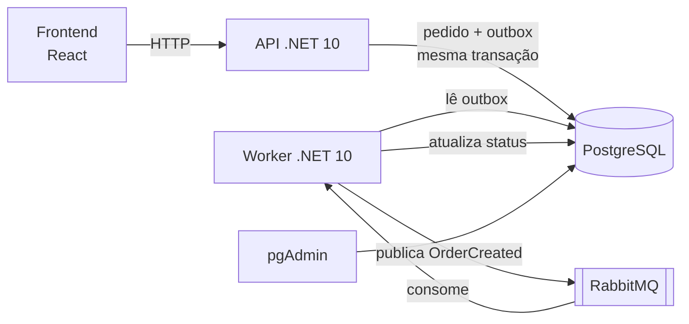
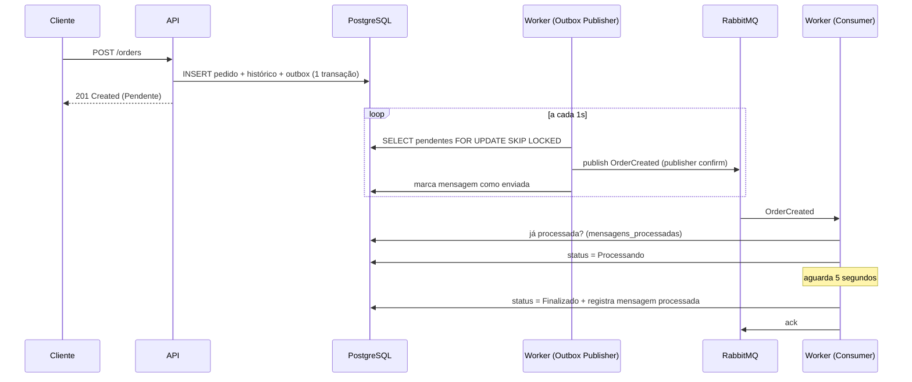
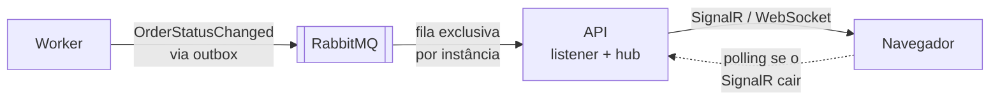
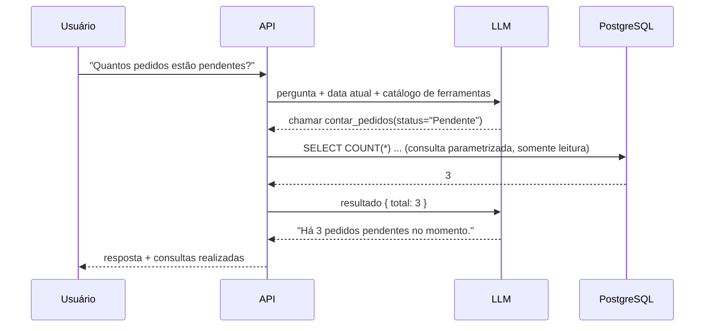

# TMB Orders — Sistema de Gestão de Pedidos

Sistema de gestão de pedidos com **processamento assíncrono via mensageria**.
Ao criar um pedido, a API grava no PostgreSQL e publica o evento `OrderCreated`.
Um worker consome o evento e avança o status do pedido: **Pendente → Processando → Finalizado**.

> 🚧 Projeto em construção — Fase 7 (módulo de IA "Pergunte sobre os pedidos") concluída.

## Arquitetura



## Stack

| Camada | Tecnologia |
|---|---|
| Backend | .NET 10 (LTS) — ASP.NET Core Minimal APIs |
| Acesso a dados | Entity Framework Core 10 + Npgsql |
| Banco de dados | PostgreSQL 17 |
| Mensageria | RabbitMQ 4 (com painel de administração) |
| Administração do banco | pgAdmin 4 |
| Frontend | React 19 + Vite + TypeScript, Tailwind CSS 4, TanStack Query, Radix UI |
| IA / Analytics | LLM via API compatível com OpenAI (OpenAI, Gemini, Groq ou Ollama) + function calling |
| Observabilidade | OpenTelemetry (traces) + Jaeger v2 |
| Infraestrutura | Docker Compose + Nginx (serve o frontend e faz proxy para a API) |

## Estrutura da solução

```
src/
├── TmbOrders.Domain           # Regras de negócio puras (Pedido, status, histórico)
├── TmbOrders.Infrastructure   # EF Core, migrations, RabbitMQ, outbox, health checks
├── TmbOrders.ServiceDefaults  # Configurações comuns (endpoints de health, telemetria)
├── TmbOrders.Api              # API REST
└── TmbOrders.Worker           # Publicador do outbox + consumidor de eventos
frontend/                      # React + Vite (servido por Nginx no Docker)
tests/
├── TmbOrders.UnitTests        # Domínio, validação e golden tests dos contratos
└── TmbOrders.IntegrationTests # API + Worker reais com PostgreSQL e RabbitMQ em Testcontainers
infra/
└── pgadmin/servers.json       # Servidor do Postgres já cadastrado no pgAdmin
```

## Como rodar

**Pré-requisito:** Docker Desktop em execução.

```bash
# 1. Crie o arquivo de variáveis de ambiente
cp .env.example .env          # Windows PowerShell: copy .env.example .env

# 2. Suba todo o ambiente
docker compose up -d --build
```

| Serviço | URL |
|---|---|
| **Frontend** | **http://localhost:3000** |
| API | http://localhost:5080 |
| Health da API | http://localhost:5080/health |
| Worker (health) | http://localhost:5081/health |
| RabbitMQ (painel) | http://localhost:15672 |
| Jaeger (traces) | http://localhost:16686 |
| pgAdmin | http://localhost:5050 |

Logins usam os valores definidos no `.env`.

## Endpoints

| Método | Rota | Descrição |
|---|---|---|
| POST | `/orders` | Cria um pedido (status inicial **Pendente**) |
| GET | `/orders` | Lista os pedidos (filtro opcional `?status=Finalizado`) |
| GET | `/orders/{id}` | Detalhes do pedido com o **histórico de status** |

Exemplo de criação:

```bash
curl -X POST http://localhost:5080/orders \
  -H "Content-Type: application/json" \
  -d '{"cliente":"Maria Silva","produto":"Notebook","valor":4599.90}'
```

O arquivo `src/TmbOrders.Api/TmbOrders.Api.http` tem todas as requisições prontas para rodar no
Visual Studio, Rider ou VS Code (extensão REST Client). Erros seguem o padrão **ProblemDetails (RFC 9457)**.

## Fluxo de mensageria



**Mensagem publicada** (exchange `orders.events`, routing key `order.created`):

- Propriedades AMQP: `message_id`, `correlation_id` (= OrderId), `type` (= OrderCreated), entrega persistente.
- Headers: `EventType: OrderCreated`, `CorrelationId: <OrderId>`, `traceparent`.
- Corpo: envelope JSON com `messageId`, `eventType`, `correlationId`, `occurredAt` e `data`.

### Confiabilidade

| Problema | Como é tratado |
|---|---|
| RabbitMQ fora do ar ao criar pedido | **Outbox Pattern**: o evento fica no banco e é publicado quando o broker voltar |
| Broker não recebeu a mensagem | **Publisher confirms**: só marca como enviada após confirmação do RabbitMQ |
| Mensagem entregue duas vezes | **Consumidor idempotente** (3 camadas: tabela de mensagens processadas, regra de domínio e índice único no histórico) |
| Erro temporário no processamento | `nack` com requeue: nova tentativa |
| Mensagem que sempre falha | Fila **quorum** com `x-delivery-limit`: após 5 entregas vai para a **DLQ** `orders.order-created.dlq` |
| JSON inválido / pedido inexistente | Vai direto para a DLQ (tentar de novo não resolveria) |
| Vários workers em paralelo | `FOR UPDATE SKIP LOCKED` no outbox; índice único impede transição duplicada |

## Tempo real (SignalR) com fallback



1. A cada mudança de status, o worker grava um evento `OrderStatusChanged` no **outbox, na mesma transação**
   do status, e "acorda" o publicador na hora (sem esperar o ciclo de 1 s).
2. A API escuta esses eventos com uma **fila temporária exclusiva por instância**: se houver várias APIs
   rodando, todas recebem todos os eventos e cada uma avisa os seus clientes conectados.
3. O hub SignalR (`/hubs/orders`) envia `OrderStatusChanged` e `OrderCreated` ao navegador, que atualiza o
   cache do TanStack Query na hora: tabela, cartões, linha do tempo e notificações reagem sem nova requisição.

**Fallback:**

| Situação | Comportamento |
|---|---|
| SignalR conectado | Eventos por push; polling só de segurança a cada 30 s |
| Conexão caiu | Indicador "Reconectando..."; reconexão automática (0 s, 2 s, 5 s, 10 s...) e **polling a cada 1,5 s** enquanto isso |
| SignalR indisponível | Indicador "Modo polling"; tudo continua funcionando por polling e a conexão é tentada de novo a cada 10 s |
| Reconectou | Recarrega os dados para recuperar eventos perdidos enquanto estava desconectado |
| WebSocket bloqueado pela rede | O cliente SignalR cai para Server-Sent Events ou long polling |

Para ver o fallback funcionando: com a tela aberta, rode `docker compose restart api` e observe o indicador
no canto superior direito.

## Módulo de IA — Pergunte sobre os pedidos

Tela **Assistente IA** (http://localhost:3000/assistente) e endpoint `POST /analytics/ask`:

```bash
curl -X POST http://localhost:5080/analytics/ask \
  -H "Content-Type: application/json" \
  -d '{"pergunta":"Qual o valor total de pedidos finalizados este mês?"}'
```

### Como funciona (function calling)



**Por que function calling em vez de deixar a LLM gerar SQL (text-to-SQL)?**

| | Text-to-SQL | Function calling (escolhido) |
|---|---|---|
| Segurança | A LLM escreve SQL arbitrário (risco de injeção, DELETE, vazamento) | A LLM só escolhe entre 7 funções somente leitura e parametrizadas |
| Corretude | Pode errar joins, fuso horário e regras de negócio | Regras (fuso, "aprovado" = Finalizado, tempo pelo histórico) ficam no código, testadas |
| Testabilidade | Difícil | Cada ferramenta tem teste de integração com banco real |
| Transparência | SQL difícil de auditar | A tela mostra quais consultas foram feitas e os resultados |

Ferramentas disponíveis: `contar_pedidos`, `resumo_por_status`, `valor_dos_pedidos`, `tempo_medio_processamento`
(pelo histórico de status: espera na fila, execução e total), `listar_pedidos`, `ranking_clientes` e `pedidos_por_dia`.

Outros cuidados:

- **Datas no fuso de Brasília:** "hoje" e "este mês" são interpretados em `America/Sao_Paulo`, não em UTC.
- **Anti-alucinação:** o prompt exige usar as ferramentas e proíbe inventar números. A resposta exibe as consultas feitas.
- **Erros recuperáveis:** parâmetros inválidos voltam como `{ "erro": ... }` para o modelo corrigir sozinho.
- **Limites:** até 5 rodadas de ferramentas por pergunta, pergunta com até 500 caracteres,
  e **rate limit** de 10 perguntas por minuto por IP (protege o custo).
- **Provedor configurável** pelo `.env`. Funciona com OpenAI, Google Gemini e Groq (os dois com cota gratuita)
  ou **Ollama local** (sem chave e sem custo). Sem configuração, a tela explica como ativar.
- A chamada à LLM aparece no **trace do Jaeger** (`ai.ask` → `ai.tool ...` → SQL e HTTP).

### Configuração

No `.env`:

```bash
# Exemplo com Google Gemini (cota gratuita: https://aistudio.google.com)
AI_BASE_URL=https://generativelanguage.googleapis.com/v1beta/openai
AI_API_KEY=sua-chave
AI_MODEL=gemini-2.5-flash
```

Depois rode `docker compose up -d api`. Veja outras opções (OpenAI, Groq, Ollama) no `.env.example`.

## Tracing ponta a ponta (OpenTelemetry + Jaeger)

Cada pedido gera **um único trace** que atravessa todos os serviços e a fila:

```
tmb-api     POST /orders
tmb-api       └ INSERT pedidos + histórico + outbox          (Npgsql)
tmb-worker      └ order.created publish                      (Producer)
tmb-worker        └ orders.order-created process             (Consumer)
tmb-worker          ├ UPDATE status = Processando             (Npgsql)
tmb-worker          ├ order.status-changed publish            (Producer)
tmb-api             │  └ amq.gen-… process → SignalR          (Consumer)
tmb-worker          ├ UPDATE status = Finalizado              (Npgsql)
tmb-worker          └ order.status-changed publish            (Producer)
tmb-api                └ amq.gen-… process → SignalR          (Consumer)
```

Como o contexto do trace sobrevive à passagem pela fila (HTTP → banco → RabbitMQ → outro processo):

1. A API grava o `traceparent` da requisição **junto com a mensagem no outbox**.
2. O publicador abre um span `publish` (Producer) como filho desse contexto e envia o header W3C
   `traceparent` na mensagem AMQP.
3. O consumidor lê o header e abre o span `process` (Consumer) como filho. Tudo o que ele faz
   (consultas, novos eventos no outbox) herda o mesmo trace.

Detalhes de implementação:

- Instrumentação: ASP.NET Core (requisições), Npgsql (comandos SQL) e spans próprios de mensageria
  seguindo as convenções semânticas do OpenTelemetry (`messaging.system`, `messaging.message.id`,
  `messaging.message.conversation_id` etc.).
- Um *sampler* customizado descarta consultas que não pertencem a nenhum trace (polling do outbox e
  health checks), evitando milhares de traces irrelevantes.
- O `trace_id` da criação fica gravado no pedido, e a tela de detalhes tem um **link direto para o trace no Jaeger**.
- Os logs incluem `TraceId`/`SpanId`, então dá para ir de uma linha de log ao trace correspondente.

## Health checks

| Endpoint | O que verifica |
|---|---|
| `/health/live` | O processo está no ar |
| `/health/ready` | Dependências: PostgreSQL e RabbitMQ |
| `/health` | Relatório completo em JSON |

O `docker-compose.yml` usa esses endpoints nos `healthcheck` de cada serviço, e a ordem de subida
respeita `depends_on: condition: service_healthy`.

## Decisões técnicas

- **.NET 10 em vez de .NET 8:** o .NET 10 é a versão LTS atual; o suporte do .NET 8 terminou em novembro/2026.
- **EF Core + migrations automáticas:** a API aplica as migrations pendentes ao iniciar. Somente a API
  migra, e o worker só sobe depois que a API está saudável, evitando corrida entre processos.
- **Colunas com os nomes do enunciado:** a tabela `pedidos` usa `id`, `cliente`, `produto`, `valor`,
  `status` e `data_criacao`. O status é gravado como texto, o que facilita a leitura no banco.
- **Duas barreiras de idempotência:** a tabela `mensagens_processadas` (chave `message_id + consumidor`) e
  um índice único `(pedido_id, status)` no histórico, que impede a mesma transição de ser gravada duas vezes.
- **Central Package Management:** versões de todos os pacotes NuGet ficam em `Directory.Packages.props`.
- **Segredos fora do código:** tudo vem de variáveis de ambiente; o `docker compose` falha com uma mensagem
  clara se uma senha obrigatória não estiver definida no `.env`.

## Frontend

- **Dashboard** com total de pedidos, pendentes, em processamento, finalizados e valor finalizado.
- **Tabela responsiva** (vira lista de cartões no celular), com filtro por status e busca.
- **Criação de pedido** em modal, com máscara de valor em R$ e erros da API exibidos por campo.
- **Detalhes do pedido** com linha do tempo do histórico de status, tempo entre etapas e link para o trace no Jaeger.
- **Feedback visual de status:** badge animado em "Processando", linha destacada quando o status muda
  e notificação (toast) ao entrar em processamento e ao finalizar.
- **Atualização em tempo real (SignalR)**, com fallback automático para polling (ver seção abaixo).
- Tema claro/escuro, estados de carregamento (skeleton), vazio e erro, e acessibilidade (teclado, aria).

No Docker, o Nginx serve o build e redireciona `/api/*` para a API, então o navegador fala com uma única
origem (sem CORS). Em desenvolvimento, o Vite faz o mesmo papel:

```bash
cd frontend
npm install
npm run dev        # http://localhost:5173 (a API precisa estar em http://localhost:5080)
```

## Testes automatizados

```bash
dotnet test TmbOrders.slnx
```

Requer apenas o **Docker em execução** (os testes de integração criam os próprios containers).

| Projeto | O que cobre |
|---|---|
| **UnitTests / Domain** | Regras do pedido: criação, sequência obrigatória Pendente → Processando → Finalizado, transição repetida ignorada (idempotência), pular etapa gera erro |
| **UnitTests / Api** | Validação do POST /orders e contratos de mensageria (routing keys, eventos obrigatórios) |
| **UnitTests / Golden** | **Golden tests** dos contratos JSON: respostas da API, mensagens do RabbitMQ e eventos do SignalR |
| **IntegrationTests** | **Dependências reais em ambiente isolado e descartável** (Testcontainers): PostgreSQL e RabbitMQ sobem em containers, a API e o Worker reais rodam em memória (`WebApplicationFactory`) |

Cenários de integração:

- POST cria o pedido, o histórico e a mensagem de outbox **na mesma transação**, com `CorrelationId = OrderId` e `EventType = OrderCreated`.
- Validação retorna 400 com erros por campo; pedido inexistente retorna 404; health check reporta banco e mensageria.
- **Fluxo completo de ponta a ponta:** API → outbox → RabbitMQ → Worker → Finalizado, com histórico na ordem correta.
- **Idempotência:** a mesma mensagem entregue duas vezes é processada uma única vez.
- **Concorrência:** duas instâncias processando a mesma mensagem ao mesmo tempo, e só uma efetiva a mudança.
- **Módulo de IA:** cada ferramenta contra o banco real (contagens, valores, tempo médio pelo histórico,
  ranking, agrupamento por dia no fuso local, parâmetros inválidos) e o *agent loop* com um modelo falso
  (determinístico, sem chamar provedor externo).

### Golden tests

Os arquivos `tests/TmbOrders.UnitTests/Golden/*.golden.json` são a "fotografia" oficial dos contratos JSON.
Se alguém alterar um contrato sem querer (renomear um campo, mudar o formato de uma data), o teste falha e
mostra a diferença. Quando a mudança for intencional:

```bash
UPDATE_GOLDEN=1 dotnet test tests/TmbOrders.UnitTests     # PowerShell: $env:UPDATE_GOLDEN=1; dotnet test ...
```

O diff dos arquivos golden aparece no Git, e toda mudança de contrato fica explícita no code review.

### Integração contínua

O workflow `.github/workflows/ci.yml` roda a cada push: build e testes do backend (incluindo os
Testcontainers, já que o Docker está disponível no runner do GitHub) e typecheck e build do frontend.

## Desenvolvimento

Gerar uma nova migration (requer o SDK do .NET 10):

```bash
dotnet tool restore
dotnet ef migrations add NomeDaMigration --project src/TmbOrders.Infrastructure --startup-project src/TmbOrders.Api --output-dir Persistence/Migrations
```
